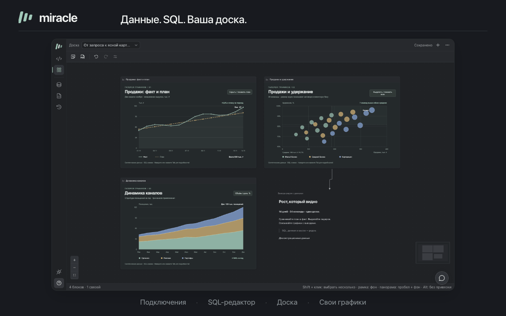
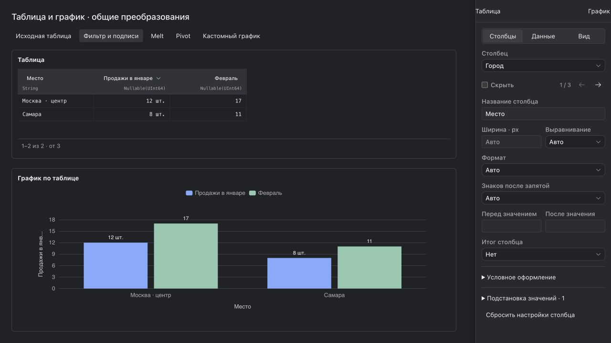

<p align="center">
  
</p>

<p align="center"><strong>Личный SQL-редактор, аналитические доски и презентации.</strong><br />ClickHouse · Trino · SQLite · Apache-2.0</p>

<p align="center"><a href="docs/assets/miracle-preview.mp4?raw=true">Скачать MP4</a> · <a href="docs/motion-preview.md">О демонстрации</a></p>

[Выпуски](https://github.com/Manannikov-Nikita/miracle/releases) · [Установка](docs/local-installation.md) · [Руководство](docs/usage.md) · [Что проверено](docs/release-validation.md)

Miracle работает на вашем компьютере и открывается в браузере. Подключитесь к ClickHouse или Trino, выполните SQL и соберите таблицы, графики и заметки на доске или слайдах презентации. Каждая папка запуска становится отдельным проектом; SQL-документы, снимки, доски, презентации и чаты агентов сохраняются в её `.miracle/`. Аккаунт, регистрация, PostgreSQL и Docker для запуска не нужны.

**English:** Miracle is a personal local SQL workspace for ClickHouse and Trino. Run queries and turn result snapshots into charts, tables, and notes on boards and presentation slides. It serves a Russian-language browser interface on loopback, stores its workspace in SQLite, and ships with its own runtime.

**Вышла 0.8.1:** обновление через CLI и актуальная поддержка платформ: macOS на Apple Silicon, GNU/Linux x64 и ARM64. Презентации, фигуры, защита объектов на время работы агента и локальный Git доступны в этой версии. [Что нового](https://github.com/Manannikov-Nikita/miracle/releases/tag/v0.8.1) · [Что проверено](docs/release-validation.md).



## Возможности

| Область   | Что можно делать                                                                                                                                                                                   |
| --------- | -------------------------------------------------------------------------------------------------------------------------------------------------------------------------------------------------- |
| SQL       | Несколько .sql-вкладок, автодополнение по части имени, форматирование, запуск выделения или запроса под курсором, время выполнения и оценка остатка при запуске по датам, импорт и экспорт файлов. |
| Таблицы   | Форматы колонок, подстановки значений, условное оформление, фильтры, итоги, сводные, melt и pivot без агрегации — [подробнее](docs/table-capabilities.md).                                         |
| Графики   | Столбцы, линии, области и точки; [кастомные SVG/HTML/Canvas-графики через агента](docs/custom-charts.md). Преобразования таблицы применяются к графику того же блока; восемь положений легенды.    |
| Доска     | Снимки результатов, Markdown с LaTeX, стикеры, фигуры, текст и свободные стрелки; направляющие, выравнивание, масштабирование, отмена и автосохранение правок.                                     |
| Презентации | Слайды 16:9, копирование блоков с доски, фон и порядок слайдов, полноэкранный показ сохранённых результатов.                                                                                     |
| Агенты    | Чаты с локальными Codex CLI и Claude CLI, файлы и открытые вкладки через `@`, блоки и слайды как контекст, защита редактируемых объектов, разрешения и остановка.                                |
| Git       | Ветка, изменения и diff, создание и переключение локальных веток, коммит выбранных файлов и статус worktree.                                                                                   |
| Проекты   | Отдельная `.miracle/` в папке проекта, независимые процессы и порты, восстановление документов и чатов из копии.                                                                                   |
| Источники | ClickHouse и Trino; поиск с подсветкой совпадений и просмотром полных имён, дерево схем с ленивой загрузкой; HTTPS и собственный CA, клиентские сертификаты для ClickHouse.                        |

Снимок хранит исходный SQL и контекст подключения. Его можно обновить независимо от открытого файла; при ошибке предыдущий результат остаётся. Изменения агента сразу появляются в редакторе, на доске и слайдах; при конфликте сохраняется локальный черновик. Редактор, доску и презентацию можно открыть по отдельности или любой парой; скрытие области сохраняет её состояние.

## Установка

Готовый установщик и архивы доступны в [выпуске 0.8.1](https://github.com/Manannikov-Nikita/miracle/releases/tag/v0.8.1). Команда ниже устанавливает последний опубликованный выпуск.

macOS на Apple Silicon, GNU/Linux x64/ARM64 и Windows через терминал WSL 2:

```sh
curl -fsSL https://github.com/Manannikov-Nikita/miracle/releases/latest/download/install.sh | sh
~/.local/bin/miracle
```

Начиная с установщика 0.3.1, если каталог команды отсутствует в PATH, он предлагает добавить его в настройки вашей оболочки. Подтвердите изменение и откройте новый терминал либо выполните напечатанную команду для текущего окна.

Если после установки появляется `miracle: command not found`, для стандартной установки в zsh или Bash выполните:

```sh
export PATH="$HOME/.local/bin:$PATH"
miracle --version
```

Для постоянной настройки и других оболочек см. [как исправить PATH](docs/local-installation.md#если-терминал-пишет-miracle-command-not-found). До настройки работают команды по полному пути: `~/.local/bin/miracle start` и `~/.local/bin/miracle stop`.

На Windows сначала нужен [WSL 2 с Linux](https://learn.microsoft.com/en-us/windows/wsl/install). Команды установки и запуска выполняются в его терминале; напечатанный адрес откройте в браузере Windows. [Полная инструкция](docs/local-installation.md) содержит требования к WSL, ручную установку, обновление и резервное копирование.

Комплект содержит Node.js; для запуска не нужны отдельные runtime, npm или Git. Панель Git использует установленный в системе Git; при необходимости путь задаётся через `MIRACLE_GIT_BINARY`. Три сборки: macOS Apple Silicon (ARM64) и GNU/Linux x64/ARM64. В WSL 2 используется Linux-сборка. ClickHouse или Trino подключаются отдельно.

После установки запускайте `miracle` из папки проекта. Команда запускает сервис и печатает `http://127.0.0.1:PORT` со свободным портом ОС. На macOS/Linux команда также открывает браузер; в WSL перейдите по напечатанному адресу в браузере Windows. Рабочая область открывается сразу, без входа.

```sh
cd ~/projects/analysis
miracle status
miracle stop
miracle open --project-dir ~/projects/other-analysis
# Фиксированный порт при необходимости:
miracle start --port 3002
```

Интерфейс предназначен для настольного браузера. Приложение рассчитано на одного человека на одном компьютере. Повторное открытие проекта использует его работающий процесс. `--data-dir` / `MIRACLE_DATA_DIR` меняет только место хранения, сохраняя папку проекта как cwd агента. Автозапуск при входе в ОС не включается.

## Обновление

```sh
miracle update --check
miracle update
```

Команда находит последний стабильный официальный выпуск, скачивает его и обновляет установленную программу. Этот же способ используется для следующих выпусков; переустанавливать программу вручную не нужно. Перед обновлением сохраните копии остановленных проектов. [Подробнее об обновлении](docs/local-installation.md#обновление).

## Сохранность данных

SQLite и ключ шифрования находятся в `PROJECT/.miracle/` отдельно от кода программы. Команда `miracle backup DIRECTORY` сохраняет их вместе с SQL-документами, досками, профилями и чатами; перед копированием остановите проект. Обычные файлы проекта и домашние настройки/авторизация провайдера не входят в копию.

После восстановления проекта проверьте и подтвердите команды профилей локально.

## Документация и разработка

- [Руководство](docs/usage.md) · [Кастомные графики](docs/custom-charts.md) · [ClickHouse HTTPS](docs/clickhouse-connections.md) · [Trino HTTPS](docs/trino-connections.md).
- [Эксплуатация](docs/operations.md) · [Проверки](docs/release-validation.md).
- [Разработка](CONTRIBUTING.md) · [Публикация](docs/releasing.md).
- [Ошибки и предложения](https://github.com/Manannikov-Nikita/miracle/issues/new/choose) · [Безопасность](SECURITY.md).

Стек: React, TypeScript, Vite, Monaco, React Flow, ECharts, TanStack Table/Virtual, Radix; Node.js 24, Fastify и SQLite.

[Apache-2.0](LICENSE). Лицензии зависимостей — [THIRD_PARTY_NOTICES.md](THIRD_PARTY_NOTICES.md).
