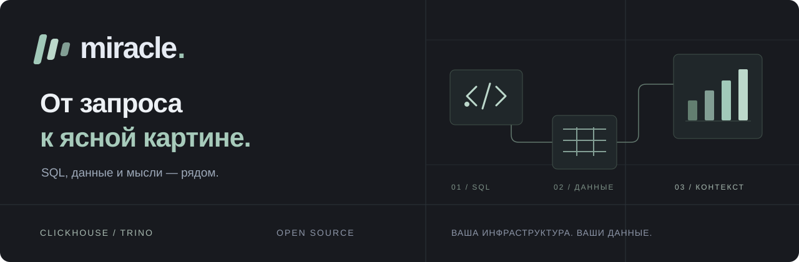

  

  <strong>SQL-редактор и аналитическая доска в одной рабочей области.</strong> 
  ClickHouse · Trino · Docker · Apache-2.0

  <a href="https://github.com/Manannikov-Nikita/miracle/releases">Скачать</a> ·
  <a href="docs/local-installation.md">Установка</a> ·
  <a href="docs/usage.md">Руководство</a> ·
  <a href="docs/release-validation.md">Что проверено</a> ·
  <a href="CONTRIBUTING.md">Участие в проекте</a>

  
  
  

Miracle помогает пройти весь путь от SQL до объяснения результата: подключиться к данным, выполнить запрос и собрать таблицы, графики и заметки на общей доске. Сохраняйте запросы в каталоге команды, возвращайтесь к снимкам и обновляйте их из исходного SQL. Интерфейс на русском, тёмная тема, компоновка в духе IDE.

**English:** Miracle is an open-source SQL workspace for ClickHouse and Trino. Explore data, keep shared queries, and turn result snapshots into charts, tables, and notes on a visual board. The interface is currently in Russian; the local Docker edition runs on your own computer.

## От запроса к результату

| Рабочая область | Что можно делать |
| --- | --- |
| **SQL** | Несколько `.sql`-вкладок, автодополнение схем и столбцов, форматирование, запуск выделения или запроса под курсором, импорт и экспорт файлов. |
| **Таблицы** | Форматы колонок, условное оформление, фильтры, итоги и сводные таблицы — [подробнее](docs/table-capabilities.md). |
| **Графики** | Столбчатый, линейный, площадной и точечный графики; оси, серии, легенда и форматы чисел. |
| **Доска** | Снимки результатов, Markdown-статьи, заметки и связи. Выравнивание, направляющие, масштабирование и отмена действий. |
| **Контекст команды** | Общий каталог запросов и досок, роли и приглашения. Личные SQL-черновики сохраняются отдельно в браузере. |
| **Источники** | Настоящие ClickHouse и Trino. Для ClickHouse — HTTPS, собственный CA, клиентские сертификаты и проверка подключения. |

Снимок на доске хранит исходный SQL и контекст подключения. Его можно обновить независимо от открытого файла; при ошибке предыдущий результат остаётся. Доски сохраняются автоматически, а при конфликте версий доступен локальный черновик.

## Запуск на своём компьютере

Нужны **Docker с Compose v2 и браузер**. Локальные Node.js, Git и сборка не требуются. ClickHouse или Trino подключаются отдельно; демонстрационные серверы и данные в комплект не входят.

1. Установите и запустите [Docker](https://docs.docker.com/get-docker/). На Windows выберите Linux containers / WSL 2.
2. Скачайте [**miracle-0.1.0.zip**](https://github.com/Manannikov-Nikita/miracle/releases/download/v0.1.0/miracle-0.1.0.zip) из [Releases](https://github.com/Manannikov-Nikita/miracle/releases) и распакуйте целиком. Нужен готовый комплект, а не архив `Source code`.
3. Запустите скрипт для своей системы:

| Система | Запуск из распакованной папки |
| --- | --- |
| Windows 11 x64 | Двойной клик по `start.cmd` |
| macOS Intel / Apple Silicon | `sh start.sh` |
| Linux x64 / ARM64 | `sh start.sh` |

Браузер откроет мастер создания администратора. Укажите имя, email и пароль, затем нажмите **«Подключить источник»**. По умолчанию Miracle доступен по `http://localhost:3001`, только на этом компьютере. Если браузер не открылся, используйте ссылку **Open Miracle** из терминала.

Повторный запуск сохраняет данные. Остановка — `stop.cmd` или `sh stop.sh`. Порт меняется в `settings.env`.

**[Полная инструкция →](docs/local-installation.md)** Подключение локальной СУБД, участники, резервная копия, перенос, обновление и решение проблем.

ZIP и готовый Docker-образ доступны публично, без входа в GitHub или GHCR. Рядом с архивом в релизе опубликована контрольная сумма SHA-256.

## Статус 0.1.0

Это ранняя версия. Локальная установка и основные сценарии проверены на **macOS Apple Silicon** с Docker Desktop. **GitHub CI прошёл на нативных Linux amd64 и arm64**, включая реальные БД, сборку образов, установку и восстановление; Windows-скрипты также прошли автоматические проверки. Полный ручной сценарий на Windows 11, macOS Intel и отдельных Linux-машинах ещё требует проверки. Windows ARM экспериментален. Точная область проверок описана в [отчёте проверки релиза](docs/release-validation.md).

Локальный комплект рассчитан на работу на одном компьютере; приглашения также открываются на нём. Совместного редактирования в реальном времени нет. Один API-процесс обслуживает одну рабочую область. Для источников используйте пользователей СУБД с правами чтения.

Перед обновлением создавайте резервную копию: она включает БД и ключ шифрования подключений. SQL-черновики в браузере сохраняйте в каталог или скачивайте отдельно. Не удаляйте Docker volumes рабочей области.

## Документация и участие

- [Руководство пользователя](docs/usage.md) — SQL, доска, сочетания клавиш и лимиты.
- [Таблицы, оформление и pivot](docs/table-capabilities.md).
- [ClickHouse: HTTPS и сертификаты](docs/clickhouse-connections.md).
- [Эксплуатация](docs/operations.md) — самостоятельное серверное размещение, резервирование и ограничения.
- [Разработка и вклад в проект](CONTRIBUTING.md) · [Публикация релизов](docs/releasing.md).
- [Сообщить об ошибке или предложить улучшение](https://github.com/Manannikov-Nikita/miracle/issues/new/choose).
- [Сообщение об уязвимости](SECURITY.md).

Стек: React, TypeScript, Vite, Monaco, React Flow, ECharts, TanStack Table/Virtual, Radix; Node.js 24, Fastify и PostgreSQL 17.

## Лицензия

[Apache-2.0](LICENSE). Лицензии и уведомления зависимостей — [THIRD_PARTY_NOTICES.md](THIRD_PARTY_NOTICES.md).
