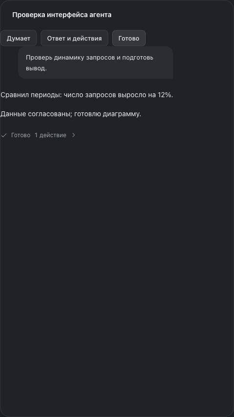
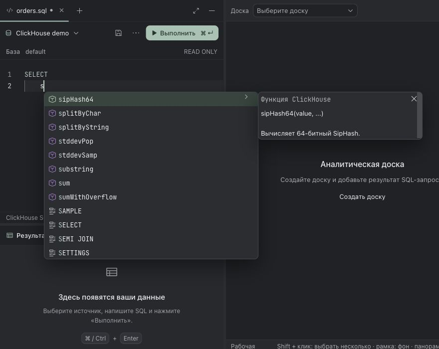

# Кандидат Miracle 0.5.1

Кандидат готовится через PR в `main`. Тег и опубликованные архивы 0.5.1 пока не созданы. Последний опубликованный выпуск и его проверки: [0.5.0](release-validation.md).

## Изменения

- Исправлена гонка события создания доски и HTTP-ответа, приводившая к двум одинаковым пунктам и заголовку `ДоскаДоска`. Более новая доска, пришедшая событием, сохраняется также в активном документе.
- Вводимый пароль можно показать в форме. Trino получает импорт поддерживаемых JDBC-параметров и отдельный браузерный вход с токенами только в памяти.
- Кастомные команды агентов корректно разделяют launcher и параметры провайдера; [сравнение с ORCA и границы совместимости](agent-command-compatibility.md) записаны отдельно.

## Проверки

Исходный `main` (`19c0ca4`) до изменений: 100 тестовых файлов, 1 180 тестов прошли на Node.js 25.8.1. Первый прогон в песочнице остановлен из-за запрета локальных сокетов (`listen EPERM`); полный повтор с доступом к сокетам прошёл.

На bundled Node.js **24.22.2** выполнены:

- `npm test`: **106 файлов, 1 246 тестов прошли** после доработки интерфейса агента.
- `npm run build`: оба TypeScript-проекта и production-сборка прошли. Осталось предупреждение Vite о размере основного JS-бандла.
- `git diff --check`: без ошибок.
- Независимое ревью: исправлены и повторно проверены блокировка пустого SSO username, откат активной доски на старую ревизию и исключение Bearer-токенов из ошибок. Открытых замечаний не осталось.

Новые сценарии включают оба порядка HTTP/SSE для доски, JDBC-импорт, реальный запуск CLI-фикстур с Unicode/пробелами, отказ обёртки от протокольных аргументов, полный HTTPS challenge/poll/query цикл, изоляцию одинаковых сохранённых подключений, перенос токена из черновика, отмену/таймаут, изменение настроек и очистку токена из HTTP/SQL-ошибок даже после конкурентного сброса кеша.

## Браузер

На отдельном временном проекте проверены:

- Показ и скрытие введённого пароля мышью и клавиатурой.
- Импорт JDBC с HTTPS, внешней авторизацией, каталогом и схемой.
- Начало входа с пустым username, отображение ссылки и ожидания, завершение polling, `SELECT version()` через кнопку проверки, сохранение и повторная проверка сохранённого подключения.
- Создание доски с названием «Доска»: статус «Сохранено» и ровно одна подпись в селекторе.

Подтверждение входа выполнял тестовый контроллер синтетического IdP с проверкой CA; настоящий корпоративный login UI не использовался. Попытка ввода SQL через автоматизацию Monaco не прошла из-за недоступного для ввода элемента; выполнение обычного SQL подтверждено API-тестами, а браузерная проверка выполнила запрос версии. Тестовый сервер остановлен после проверки.

## Доработка интерфейса агента

Индикатор «Думает» / «Работает» вращается только для выполняющегося хода. При системном уменьшении движения анимация выключается. Сводка вызовов инструментов находится после ответа в своём ходе; до появления текста ответа она остаётся видимой. Диалог подробностей и запросы разрешений сохранены.

Проверены 9 тестов отображения диалога, включая потоковый ответ, 200 событий инструментов, несколько ходов и доступность разрешений. В браузере на синтетической странице с настоящими компонентами подтверждены меняющаяся матрица вращения, отсутствие анимации после завершения и закрытие журнала клавишей Escape. Повторные полный набор, сборка и независимое ревью прошли. PR остаётся черновиком; эти проверки не означают готовность всего выпуска.

## Автодополнение SQL

Всплывающие виджеты Monaco перенесены в отдельный слой вне обрезающих resizable-панелей. Слой создаётся до редактора, удаляется вместе с ним и находится ниже модальных окон. Меню получило цвета Miracle, мятное выделение, строки высотой 28 px, скругления и тень.

После изменения прошли 4 связанных тестовых файла (93 теста: SQL-подсказки, вкладки и синхронизация редактора), `npm run build` и независимое ревью. Полный прогон 1 246 тестов выше относится к предыдущему изменению интерфейса агента.

В браузере проверены настоящий SQL-компонент с синтетическими данными и production-сборка на отдельном временном проекте: список выходит за нижнюю и правую границы редактора, вариант за пределами редактора выбирается мышью, ↓/Enter вставляет выбранную функцию, Escape закрывает список. На панели шириной 420 px список остаётся доступен. При размонтировании редактора внешний контейнер удаляется. В production подтверждены автоматическое открытие при вводе, оформление меню и описание функции поверх соседней доски. Запросы к пользовательским источникам не выполнялись.

Описание функции подстраивается по высоте уже при первом открытии: до первого измерения задана начальная ширина Monaco, текст описания использует более компактный межстрочный интервал. В браузере короткое описание занимает 96 px вместо 220 px, более длинное — 116 px, возврат к короткому снова даёт 96 px. Синтетическое описание из 60 строк ограничивается экраном и прокручивается. Повторные production-сборка, браузерная проверка первого открытия и независимое ревью прошли.

## Границы подтверждения

Корпоративный адрес и IdP пользователя не используются в тестах. Локальные HTTPS/OAuth и CLI-фикстуры подтверждают протокол, но не заменяют проверку конкретного корпоративного развёртывания и реальных провайдеров. Публикация и установочные проверки четырёх платформ относятся к отдельной приёмке выпуска.

Установленный Codex CLI 0.136.0 прошёл проверку возможностей с моделью, approval и sandbox; модельный запрос не выполнялся. Реальный Claude CLI в среде отсутствует. Обезличенная фикстура команды-обёртки подтверждает сохранение аргументов; обёртка, которая не принимает `stream-json` и другие обязательные параметры Claude, остаётся несовместимой со структурированным чатом. Для произвольных интерактивных команд нужен отдельный терминальный режим или адаптер.
