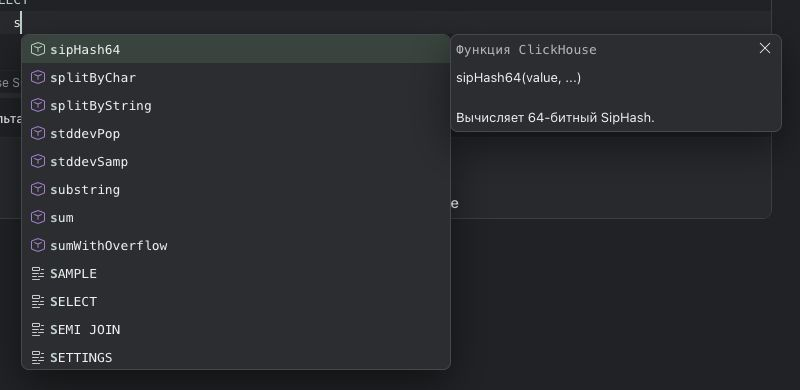
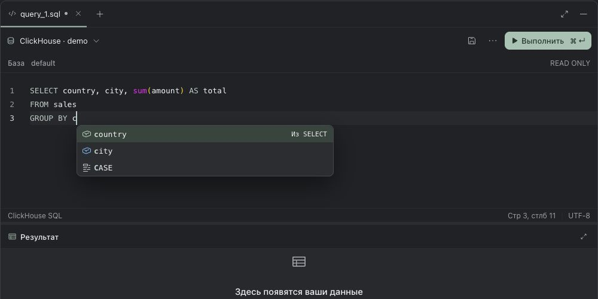

# Проверки изменений Miracle 0.5.1

Изменения включены в `main` через [PR #4](https://github.com/Manannikov-Nikita/miracle/pull/4), merge-коммит `8710443a84bda1af47bf44ce9ec1450ea3583ddb`. Тег `v0.5.1` указывает на этот коммит. Итоги CI, публикации и установочных проверок собраны в [сводном отчёте выпуска](release-validation.md); проверки предыдущей версии сохранены в [отчёте 0.5.0](release-validation-0.5.0.md).

## Изменения

- Исправлена гонка события создания доски и HTTP-ответа, приводившая к двум одинаковым пунктам и заголовку `ДоскаДоска`. Более новая доска, пришедшая событием, сохраняется также в активном документе.
- Вводимый пароль можно показать в форме. Trino получает импорт поддерживаемых JDBC-параметров и отдельный браузерный вход с токенами только в памяти.
- Кастомные команды агентов корректно разделяют launcher и параметры провайдера; [сравнение с ORCA и границы совместимости](agent-command-compatibility.md) записаны отдельно.

## Проверки

До изменений исходный `main` (`19c0ca4`) проходил 100 файлов / 1 180 тестов на Node.js 25.8.1. Первый запуск в песочнице был остановлен ограничением локальных сокетов; повтор с доступом к сокетам прошёл. Итоговые результаты ниже относятся к Node.js 24.22.2 и всем изменениям выпуска.

На bundled Node.js **24.22.2** выполнены:

- `npm test`: **109 файлов, 1 339 тестов прошли** после всех изменений выпуска.
- `npm run build`: оба TypeScript-проекта и production-сборка прошли. Осталось предупреждение Vite о размере основного JS-бандла.
- `git diff --check`: без ошибок.
- Независимое ревью: исправлены и повторно проверены блокировка пустого SSO username, откат активной доски на старую ревизию и исключение Bearer-токенов из ошибок. Открытых замечаний не осталось.

Новые сценарии включают оба порядка HTTP/SSE для доски, JDBC-импорт, реальный запуск CLI-фикстур с Unicode/пробелами, отказ обёртки от протокольных аргументов, полный HTTPS challenge/poll/query цикл, изоляцию одинаковых сохранённых подключений, перенос токена из черновика, отмену/таймаут, изменение настроек и очистку токена из HTTP/SQL-ошибок даже после конкурентного сброса кеша.

## Браузер

На отдельном временном проекте проверены:

- Показ и скрытие введённого пароля мышью и клавиатурой.
- Импорт JDBC с HTTPS, внешней авторизацией, каталогом и схемой.
- Начало входа с пустым username, отображение ссылки и ожидания, завершение polling, `SELECT version()` через кнопку проверки, сохранение и повторная проверка сохранённого подключения.
- Создание доски с названием «Доска»: статус «Сохранено» и ровно одна подпись в селекторе.

Подтверждение входа выполнял тестовый контроллер синтетического IdP с проверкой CA; настоящий корпоративный login UI не использовался. Попытка ввода SQL через автоматизацию Monaco не прошла из-за недоступного для ввода элемента; выполнение обычного SQL подтверждено API-тестами, а браузерная проверка выполнила запрос версии. Тестовый сервер остановлен после проверки.

## Доработка интерфейса агента

Индикатор «Думает» / «Работает» вращается только для выполняющегося хода. При системном уменьшении движения анимация выключается. Сводка вызовов инструментов находится после ответа в своём ходе; до появления текста ответа она остаётся видимой. Диалог подробностей и запросы разрешений сохранены.

Проверены 9 тестов отображения диалога, включая потоковый ответ, 200 событий инструментов, несколько ходов и доступность разрешений. В браузере на синтетической странице с настоящими компонентами подтверждены меняющаяся матрица вращения, отсутствие анимации после завершения и закрытие журнала клавишей Escape. Повторные полный набор, сборка и независимое ревью прошли. Итоговый полный прогон всего выпуска указан выше.

## Автодополнение SQL

Всплывающие виджеты Monaco перенесены в отдельный слой вне обрезающих resizable-панелей. Слой создаётся до редактора, удаляется вместе с ним и находится ниже модальных окон. Меню получило цвета Miracle, мятное выделение, строки высотой 28 px, скругления и тень.

После изменения прошли 4 связанных тестовых файла (93 теста: SQL-подсказки, вкладки и синхронизация редактора), `npm run build` и независимое ревью. После завершения контекстных рекомендаций полный набор составил 109 файлов / 1 339 тестов; он прошёл вместе со сборкой.

В браузере проверены настоящий SQL-компонент с синтетическими данными и production-сборка на отдельном временном проекте: список выходит за нижнюю и правую границы редактора, вариант за пределами редактора выбирается мышью, ↓/Enter вставляет выбранную функцию, Escape закрывает список. На панели шириной 420 px список остаётся доступен. При размонтировании редактора внешний контейнер удаляется. В production подтверждены автоматическое открытие при вводе, оформление меню и описание функции поверх соседней доски. Запросы к пользовательским источникам не выполнялись.

Описание функции подстраивается по высоте уже при первом открытии: до первого измерения задана начальная ширина Monaco, текст описания использует более компактный межстрочный интервал. В браузере короткое описание занимает 96 px вместо 220 px, более длинное — 116 px, возврат к короткому снова даёт 96 px. Синтетическое описание из 60 строк ограничивается экраном и прокручивается. Повторные production-сборка, браузерная проверка первого открытия и независимое ревью прошли.

Устранена лишняя полоса прокрутки справа у короткого описания: глобальный `border-box` отнимал 2 px рамки от рассчитанной Monaco высоты содержимого. Для карточки восстановлен `content-box`. Проверено в браузере: у короткого текста `clientHeight = scrollHeight = 96`, полоса скрыта; у длинного `clientHeight = 445`, `scrollHeight = 2436`, прокрутка доступна. Сборка прошла.

## Контекстные рекомендации SQL

Автокомплит разбирает текущий блок SELECT и положение курсора, сохраняя выражения, цитирование и алиасы. В `GROUP BY` первыми идут неагрегатные выбранные поля с пометкой «Из SELECT», в `ORDER BY` — выбранные выражения и алиасы, включая агрегатные. Завершённые элементы списков исключаются из повторных предложений; текущий недописанный элемент остаётся доступным. В `FROM`/`JOIN` приоритет получают источники, в выражениях — колонки используемых таблиц. Неуместные ключевые слова источников не предлагаются в группировке/сортировке.

Для Trino группировка вставляет исходное выражение, а сортировка может использовать его алиас. Для ClickHouse группировка допускает скалярный алиас, если он не затеняет входную колонку. См. [Trino SELECT](https://trino.io/docs/current/sql/select.html#group-by-clause) и [ClickHouse aliases](https://clickhouse.com/docs/reference/syntax#expression-aliases). Агрегатные, оконные выражения и зависимости от агрегатных алиасов не продвигаются как ключи группировки. Распознаются встроенные функции, доступные метаданные сервера и комбинаторы ClickHouse.

Проверены 150 связанных тестов: текущий блок/внешние коррелированные алиасы, CTE и UNION, литералы/комментарии, выражения и цитированные имена, диалектная вставка, завершённые ключи, лимит списка, агрегаты/окна и операторы `IS DISTINCT FROM`, `AT TIME ZONE`, `ILIKE`. Финальный полный прогон на Node.js 24.22.2: **109 файлов, 1 339 тестов прошли**; `npm run build` и `git diff --check` прошли. Независимое ревью нашло и повторно проверило исправления для коррелированных алиасов, операторов и оконных функций в каталоге.

В браузере на настоящем SQL-компоненте с синтетическим каталогом проверены обычный ввод префикса, порядок рекомендаций, вставка `GROUP BY country, city` клавишей Enter, отсутствие агрегатного `total` в группировке и его вставка в `ORDER BY`. Ошибок консоли в финальной проверке не было; запросы к пользовательским источникам не выполнялись.

Анализатор предназначен для незавершённого редакторского текста, а не для проверки корректности SQL сервером. Выходные схемы CTE/derived tables не выводятся, классификация неизвестных UDF без метаданных не гарантируется. Существующие подсказки по доступным метаданным сохранены.

## Границы подтверждения

Корпоративный адрес и IdP пользователя не используются в тестах. Локальные HTTPS/OAuth и CLI-фикстуры подтверждают протокол, но не заменяют проверку конкретного корпоративного развёртывания и реальных провайдеров. Итоги публикации, установочных проверок четырёх платформ и публичных обновлений фиксируются отдельно в [сводном отчёте выпуска](release-validation.md).

Установленный Codex CLI 0.136.0 прошёл проверку возможностей с моделью, approval и sandbox; модельный запрос не выполнялся. Реальный Claude CLI в среде отсутствует. Обезличенная фикстура команды-обёртки подтверждает сохранение аргументов; обёртка, которая не принимает `stream-json` и другие обязательные параметры Claude, остаётся несовместимой со структурированным чатом. Для произвольных интерактивных команд нужен отдельный терминальный режим или адаптер.
