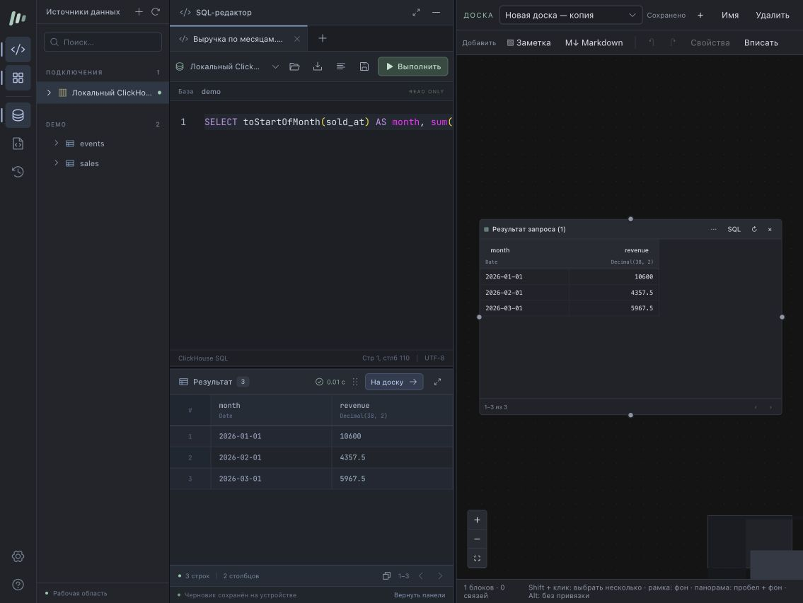

# Проверка локальной версии 0.2.0

Эта версия заменяет Docker/PostgreSQL-поставку на native-приложение с SQLite. Старые результаты не подтверждают работу новых установщиков.

Проверено 30 октября 2026 на macOS arm64, Node.js 24.22.2:

- Полный набор тестов: 44 файла, 598 тестов прошли, пропусков нет.
- Сборка клиента и сервера: прошла. Vite предупреждает о размере основного клиентского чанка.
- Финальный архив `miracle-0.2.0-darwin-arm64.tar.gz`: прошли установка и повторная установка, запуск без системного Node.js в PATH, проверка статуса и остановка, сохранность данных, backup/restore и права доступа. Проверялся путь с пробелами и Unicode.
- Интеграция SQLite + ClickHouse + Trino: 11 групп проверок прошли, включая точность чисел, лимиты, отмену, версии досок, резервные копии, ленивые метаданные и объединение результатов по дням, календарным неделям и месяцам.
- ClickHouse HTTPS/mTLS: 6 групп проверок прошли.
- Браузер: подключение ClickHouse, выполнение и сохранение SQL, создание доски со снимком, сохранность после перезапуска. Обе открытые вкладки восстанавливают локальную сессию; конфликт версий доски сохраняет черновик и позволяет сохранить копию.
- Независимое ревью приложения и установки завершено; обнаруженные проблемы исправлены и проверены регрессионными тестами.
- `git diff --check`: без ошибок. CodeGraph: индекс актуален, `.codegraph/` исключён из Git.

GitHub Release 0.2.0 ещё не опубликован. GitHub CI проверяет четыре архива: macOS x64/arm64 и Linux x64/arm64. Актуальные результаты доступны в [PR #1](https://github.com/Manannikov-Nikita/miracle/pull/1).

## Интроспекция, запуск по датам и графики

- Проверены переход SQLite со схемы 1 на 2, совместимость backup/restore, повторы без дубликатов, остановка и восстановление прерванной серии, квоты и срок хранения частичных результатов.
- В браузере проверены календарные границы, появление строк до завершения серии, восстановление активного запуска после перезагрузки страницы, остановка с сохранением 12 строк, продолжение после ошибки отдельной даты и обычный запуск SQL.
- Независимое ревью и регрессионные проверки закрыли ошибки сравнения заголовков, очистки долгих выгрузок, восстановления загрузки результата и пагинации при сетевой ошибке.
- Меню типов графиков проверено в браузере: миниатюры, выбор с клавиатуры и возврат фокуса после закрытия.
- Горизонтальные столбцы проверены в ECharts SVG и браузере: ориентация осей, сортировка, отрицательные значения, несколько серий, накопление, сохранение и восстановление доски.

Windows использует Linux-сборку внутри WSL 2. В тестах проверен запуск с окружением WSL и пустым PATH: сервис работает, команда печатает адрес для браузера Windows без Linux GUI или PowerShell. Связка WSL 2 и браузера Windows на реальном Windows-хосте не проверялась; обычный Linux CI её не заменяет.

Интерфейс в браузере с синтетическими данными тестового ClickHouse:

Историческая проверка Docker-релиза сохранена отдельно: [0.1.0 — 23 октября 2026](release-validation-0.1.0.md).
